```text
  __                                 __    
 /  |                               /  |   
 $$ |   __  _____  ____    _______  $$ |__ 
 $$ |  /  |/     \/    \  /       \ $$    \
 $$ |_/   /$$$$$$  $$$$  |/$$$$$$$  |$$$$$$$ \
 $$   /$$< $$ | $$ | $$ |$$      \  $$ |  $$ |
 $$$$$$\  \$$ | $$ | $$ | $$$$$$  | $$ |  $$ |
 $$ |  $$ |$$ | $$ | $$ |/     $$/  $$ |  $$ |
 $$/   $$/ $$/  $$/  $$/ $$$$$$$/   $$/   $$/  
                                              
 [ CONTROL IS AN ILLUSION. HELLO, FRIEND. ]
```

### 👤 `ɪᴅᴇɴᴛɪᴛʏ: vymsk`
> *“Are you a one or a zero? That's the question you have to ask yourself.”*

<p align="center">
  
</p>

---

### 💻 `ᴛᴏᴏʟs & ᴀʀsᴇɴᴀʟ`

<p align="left">
  
</p>

---

### 📡 `sʏsᴛᴇᴍ ᴍᴏɴɪᴛᴏʀ`

<p align="left">
  
</p>

<p align="left">
  
</p>

---

```bash
root@vymsk:~# echo "Goodbye, friend." && exit 0
```
